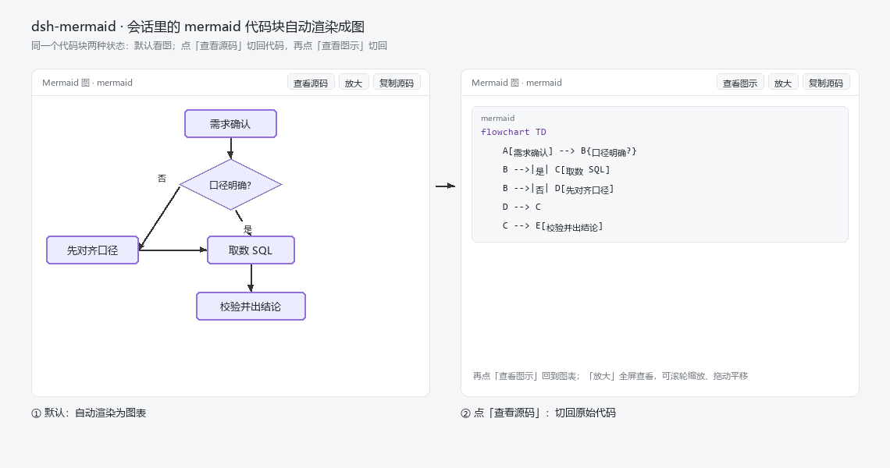

# dsh-mermaid

把会话里的 mermaid 代码块（`` ```mermaid `` 围栏）**直接画成图**的 DSH 插件。

## 现在的问题

DSH 会话里出现 mermaid 代码块时，默认只是**一段代码**：

1. **看不到图** —— `flowchart TD ...` 全是指令，节点和箭头只能自己在脑子里还原
2. **没法放大** —— 会话区域就那么大，节点一多就挤成一团，想看清细节没地方放大
3. **复用麻烦** —— 想把源码拿走，只能手动框选复制

## 效果



装上之后，同一个代码块会变成：

- **自动渲染成图**：进会话直接画出流程图，不需要点任何按钮
- **图 ↔ 源码一键切换**：工具条 `查看源码` / `查看图示`
- **放大全屏**：工具条 `放大`，支持滚轮缩放、拖动平移
- **复制源码**：工具条 `复制源码`，一键拷走

## 安装

### 桌面端 App（推荐，普通用户用这个）

1. 打开左侧栏最下方的 **插件**
2. 点 **安装**，粘贴下面这行（这就是安装地址，不是命令）：

   ```
   https://github.com/zach-bworld/dsh-mermaid
   ```

   也接受这几种写法，效果一样：
   - `github:zach-bworld/dsh-mermaid`
   - `git@github.com:zach-bworld/dsh-mermaid.git`
   - 本地目录绝对路径（先 clone 下来）

3. 安装完成后在列表里**启用**它
4. **刷新页面**（Ctrl+R）或重开窗口

> 为什么不用命令行：桌面端的 profile 由 App 独占管理，在 PowerShell 里执行 `dsh plugin --profile desktop add …` 会报
> `profile "desktop" is managed exclusively by the Electron application`。这是设计如此，不是你的问题。

### 命令行 / Web 端

```bash
dsh plugin --profile web add github:zach-bworld/dsh-mermaid
```

`web` 换成你自己的 profile 名即可（常见：`web`、`tui`、`headless`）。
装完刷新页面。

### 装指定版本

```bash
dsh plugin --profile web add github:zach-bworld/dsh-mermaid#v1.0.0
```

### 卸载

在 App 的插件页移除；或命令行：

```bash
dsh plugin --profile web remove @…/dsh-mermaid
```

### 装不上怎么办

| 现象 | 原因 / 处理 |
| --- | --- |
| 命令行报 `managed exclusively` | 桌面端请走 App 内的插件页 |
| 装完没反应 | 客户端 bundle 需要刷新页面才加载 |
| 提示找不到包 | 检查拼写：`github:zach-bworld/dsh-mermaid`（冒号、斜杠都是必需的） |

## 更多

实现原理、调试方法、已知限制见 [docs/implementation.md](docs/implementation.md)。

## License

MIT
